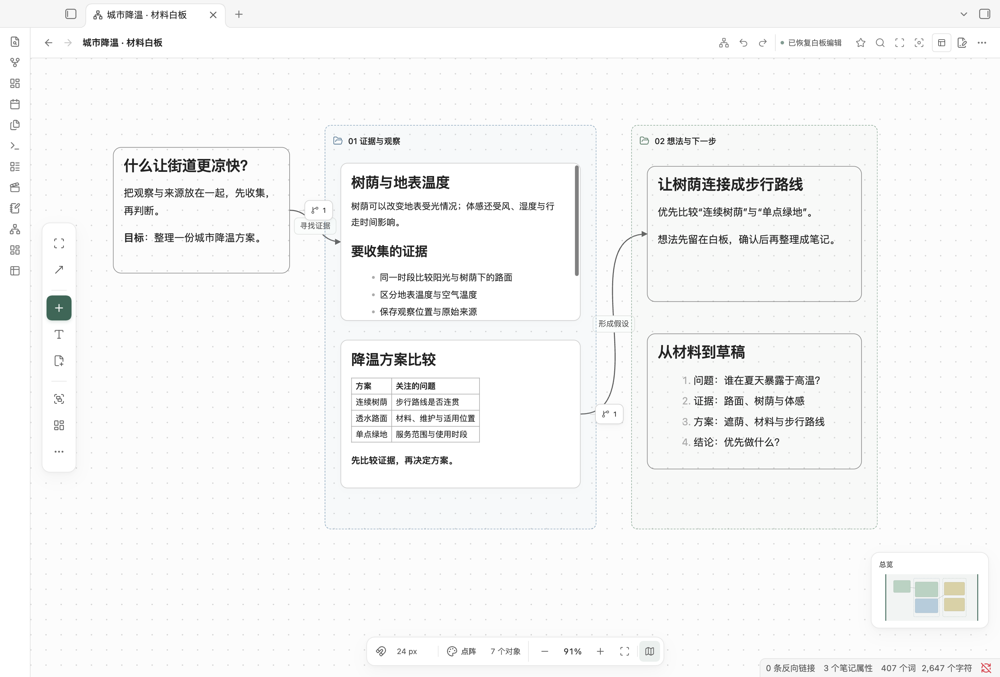
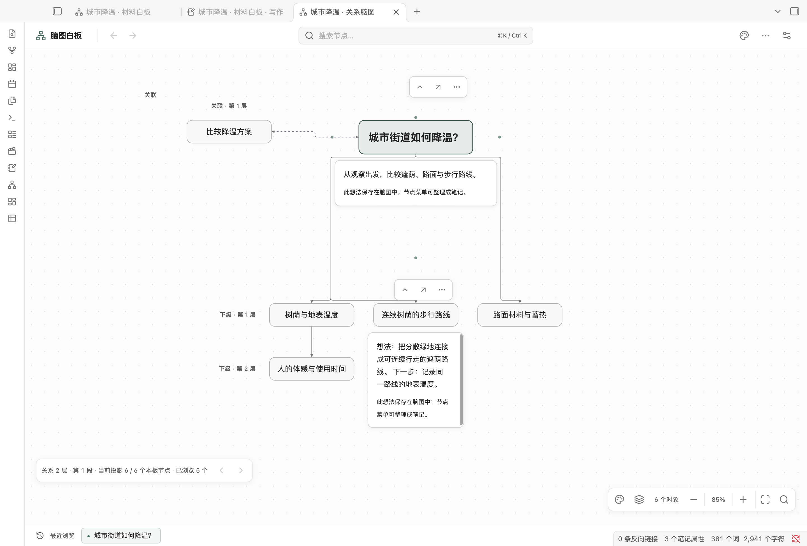
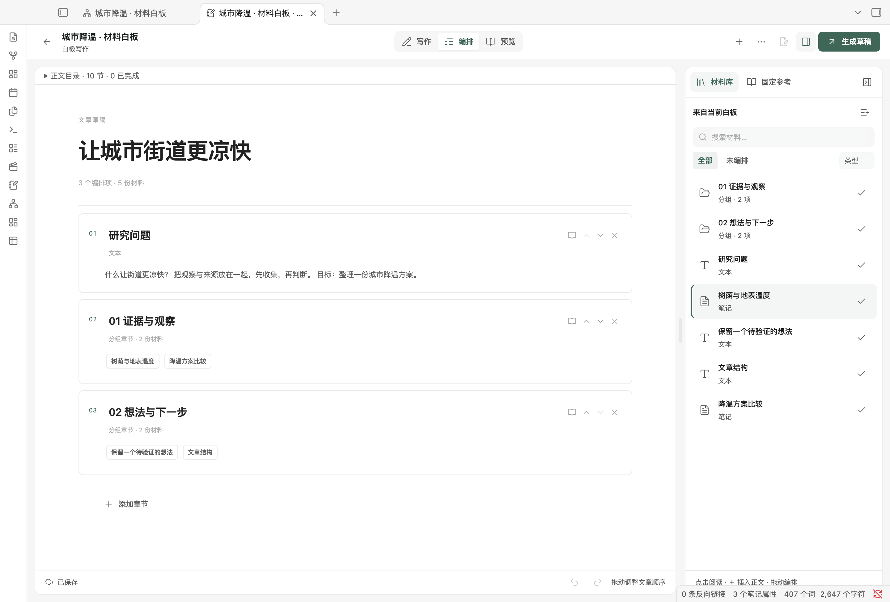

# ThoughtSpace Whiteboard

Collect research material, connect ideas, and shape long-form writing inside Obsidian. Every note, Markdown whiteboard, highlight reference, and generated draft stays in your local vault.

**English** · [简体中文](README.zh-CN.md)

**1.3.54 · Obsidian 1.13.7+ · MIT**

**[Complete English guide](docs/USER-GUIDE.md) · [中文完整教程](docs/USER-GUIDE.zh-CN.md) · [Install or update](#install-or-update) · [Ten-minute start](docs/USER-GUIDE.md#quick-start) · [Latest release](https://github.com/YuguangLi-lab/obsidian-thoughtspace/releases/latest)**

---

## Highlights (up to 1.3.54)

- **Unified Warm-Paper & Charcoal Visual System**: Calm `#f8f5ef` warm-white paper surfaces in light mode and low-saturation charcoal (`#18191b` / `#222326` / `#323339`) in dark mode, with vector paper grain, quiet save indicators, hover-reveal thin card scrollbars, and automatic duplicate H1 card-title compaction.
- **Card Library (List · Table · Kanban)**: Browse vault cards with instant IME-safe search, multi-facet removable filter chips, sticky-column tables, collapsible responsive Kanban lanes with drag-and-drop status updates, and one-click status/category (`thoughtspace_choice`) chips. Supports both English and Chinese interfaces.
- **PDF & Media Highlight Notes**: Turn PDF selections and audio/video timestamps into native Markdown highlight notes referenced across multiple boards, and jump straight back to the exact PDF page range or media timestamp with **回到高亮来源**.
- **Three Board Modes + Local View Export**: Work on ordinary freeform Markdown whiteboards, dedicated bidirectional brain boards, or stroke-editable handwriting boards. Export the current board view locally as PNG or PDF without external uploads.
- **Writing Studio**: Arrange cards, groups, and chapters with visual drag handles, pin live source references with remembered reading scroll positions, and generate a clean standalone Markdown manuscript without rewriting source notes.

---

## From material to a draft

### 1. Collect on a whiteboard

Bring notes, PDFs, images, audio, and video together. Group evidence, keep excerpts and ideas nearby, and retain live links to source files.

### 2. Connect ideas in a brain board

Build parent/child branches and left/right bidirectional associations around a current center. Keep an idea in the graph, then create a note or link an existing note while preserving the idea. Show 1–5 relationship hops, search, and page through larger graphs.

### 3. Arrange and write

Open the writing workspace, drag chapters, cards, and groups into article order, pin references, write or preview, and generate a separate Markdown draft.

*Teaching example shown in a dedicated synthetic vault (“Urban cooling research”).*

---

## Choose a starting point

| Your goal | Guide |
| --- | --- |
| Browse all cards in List, Table, or Kanban and jump to board occurrences | [Library and card boxes](docs/LIBRARY-CARDBOXES.zh-CN.md) · [User guide](docs/USER-GUIDE.md) |
| Create an ordinary, brain, or handwriting board and choose its file format | [Boards and files](docs/USER-GUIDE.md#boards) · [Markdown boards](docs/markdown-boards.zh-CN.md) |
| Capture body-first notes and navigate to their exact board references | [Collection workspace](docs/COLLECTION-WORKSPACE.zh-CN.md) |
| Select and edit whole ink strokes, export SVG, or compare recovery versions | [Handwriting](docs/HANDWRITING-IPAD.zh-CN.md) |
| Insert notes, PDFs, and images; edit cards and groups | [Board objects](docs/USER-GUIDE.md#objects) |
| Organize relationships and fold or expand reading | [Mind maps and brain boards](docs/USER-GUIDE.md#mind-maps) |
| Read sources, take excerpts, and watch audio/video with timestamped notes | [Reading](docs/USER-GUIDE.md#reading) · [Audio and video](docs/USER-GUIDE.md#audio-video) |
| Order an outline, pin references, and generate a draft | [Writing](docs/USER-GUIDE.md#writing) |
| Validate or exclusively create boards from the standalone local CLI | [AI board CLI (`tools/`)](tools/README.md) · [Format contract](docs/AI-BOARD-FORMAT.zh-CN.md) |

---

## Install or update

1. In Obsidian **Settings → Community plugins**, search for **ThoughtSpace Whiteboard**, install, and enable it.
2. For manual installation, download **`main.js`, `manifest.json`, and `styles.css`** from the [latest Release](https://github.com/YuguangLi-lab/obsidian-thoughtspace/releases/latest), and place them in `<vault>/.obsidian/plugins/thoughtspace/` (or your custom configuration folder).
3. To update manually, replace only `main.js`, `manifest.json`, and `styles.css` while keeping `data.json`, `collection-drafts/`, and other local plugin data, then reload Obsidian.
4. Open the ThoughtSpace ribbon icon (first item: **Card Library**) or run **新建白板或脑图…** from the command palette.

---

## Files, saving, and verification boundaries

- **Native Markdown & Legacy Compatibility**: Markdown boards store real Obsidian Properties, regular prose, and a plugin-managed layout section (do not hand-edit the layout JSON). Existing `.thoughtspace` boards remain supported and can be copied via **另存为 Markdown 白板**.
- **Source Note Ownership**: Editing a note card in place writes to that source note with conflict protection; removing a card reference from a board or the Card Library never deletes the underlying note.
- **Local Export & CLI Boundaries**: Local PNG/PDF view export draws visible card titles, groups, and routed connections locally without uploading data (embedded raster images, PDF page pixels, and handwriting ink are omitted). The standalone CLI (`tools/`) validates/inspects and exclusively creates files offline without adding an AI service or network dependency to the plugin.
- **Verification Scope**: Automated checks cover desktop Chromium/Electron layouts, CSS `@scope` calendar isolation, WCAG contrast ratios, and responsive container simulations. Physical iOS/Android devices, Apple Pencil palm rejection, system mobile IMEs, and mobile WebViews remain unverified on hardware. See [Troubleshooting](docs/USER-GUIDE.md#troubleshooting) and [Security](SECURITY.md).

## Project

[Issues](https://github.com/YuguangLi-lab/obsidian-thoughtspace/issues) · [Changelog](CHANGELOG.md) · [Contributing](CONTRIBUTING.md) · [MIT license](LICENSE) · [Third-party licenses](THIRD_PARTY_NOTICES.md)

Development uses Node.js 22+: `npm ci` → `npm run lint` → `npm test` → `npm run build`. Release assets are built by GitHub Actions with artifact provenance attestations.
