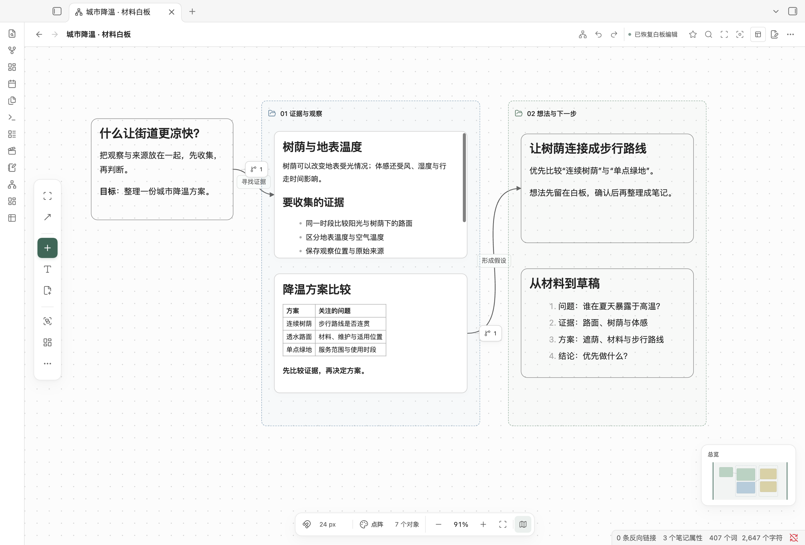
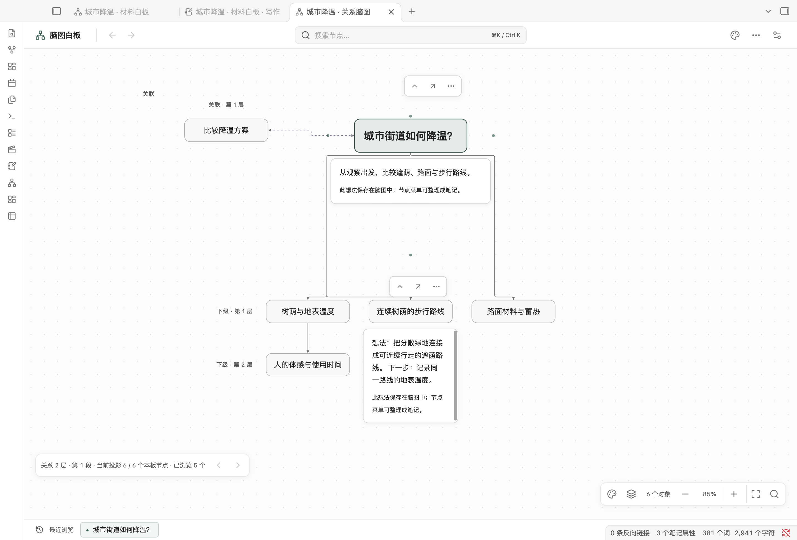
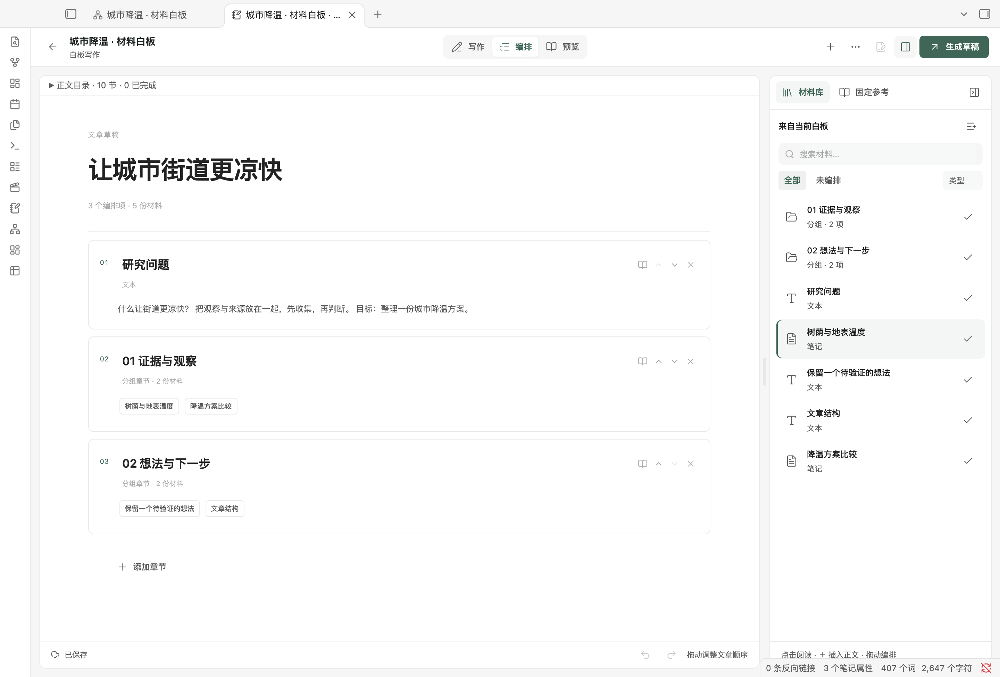

# ThoughtSpace Whiteboard（思维白板）

在 Obsidian 中收集研究材料、梳理多维关系，并编排成独立文章草稿。所有笔记、Markdown 白板、高亮引用与生成的文稿均保存在你的本地仓库中。

[English](README.md) · **简体中文**

**1.3.55 · Obsidian 1.13.7+ · MIT**

**[完整中文教程](docs/USER-GUIDE.zh-CN.md) · [Complete English guide](docs/USER-GUIDE.md) · [安装与更新](#安装或更新) · [十分钟上手](docs/USER-GUIDE.zh-CN.md#quick-start) · [下载最新版 Release](https://github.com/YuguangLi-lab/obsidian-thoughtspace/releases/latest)**

---

## 核心特性（已更新至 1.3.55）

- **暖白纸面与低饱和炭灰视觉体系**：浅色采用柔和暖白 `#f8f5ef` 与无偏色矢量纸纹，深色采用低饱和炭灰层级（面板 `#18191b` / 页面 `#222326` / 浮层 `#323339`）；配备静默保存状态点、卡片悬停细微滚动条、底部阅读渐隐遮罩，并默认折叠与正文首行 H1 重复的卡片外壳标题。
- **卡片库（列表 · 表格 · 响应式看板）**：从左侧功能区图标首项或侧栏「卡片」页一键打开。支持中文输入法友好的实时检索、单项可清除筛选胶囊、首列固定表格、带状态色点与分区折叠的多列响应式看板，支持直接点击状态/分类（`thoughtspace_choice`）标签快捷修改或跨状态泳道拖拽更新，并支持中英双语界面。
- **PDF 选区与音视频时间戳高亮笔记**：摘录自动沉淀为带来源属性的独立 Markdown 笔记并作为引用卡片放入多块白板，通过「回到高亮来源」一键跳回对应 PDF 页码范围或音视频时间点。
- **三种白板形态与本地视图导出**：支持普通自由白板、四向关联独立脑图与整笔套索手写白板（单文件 Markdown 白板保留原生 Properties 与正文）；支持将当前白板视野导出为本地 PNG 或 PDF。
- **白板写作工作台**：带拖拽抓手可视化编排卡片、分组与自建章节，固定原文参考并记忆各篇材料阅读位置，一键生成独立 Markdown 草稿而不改写原笔记。

---

## 一条研究与写作路径

### 1. 在白板收集材料

把已有笔记、PDF、图片、音视频放在一起。分组整理证据，记录摘录与想法；引用卡片继续指向来源文件。

### 2. 用脑图梳理关系

围绕当前中心建立父子分支和左右双向关联。想法先留在图里，之后可新建笔记，或保留原想法并关联已有笔记；关系显示层级支持 1–5 层，大图可继续搜索和翻页。

### 3. 把材料编排成文章

进入白板写作，拖动章节抓手调整卡片、分组与章节顺序，固定参考资料，写作或预览，再生成独立 Markdown 草稿。

*教学示例运行于专用合成库（“城市降温研究”）。*

---

## 选择你的入口

| 想做什么 | 教程入口 |
| --- | --- |
| 在卡片库用列表、表格、看板检索属性并定位白板引用 | [资料库与卡片盒](docs/LIBRARY-CARDBOXES.zh-CN.md) · [完整教程](docs/USER-GUIDE.zh-CN.md) |
| 新建普通白板、独立脑图或手写白板，选择文件格式 | [新建与文件](docs/USER-GUIDE.zh-CN.md#boards) · [单文件 Markdown 白板](docs/markdown-boards.zh-CN.md) |
| 随手记录正文，再定位具体白板引用并返回 | [收集页](docs/COLLECTION-WORKSPACE.zh-CN.md) |
| 整笔圈选编辑、导出 SVG、核对恢复版本 | [手写白板](docs/HANDWRITING-IPAD.zh-CN.md) |
| 插入笔记、PDF、图片，编辑卡片与分组 | [白板对象](docs/USER-GUIDE.zh-CN.md#objects) |
| 理清主题与关系，折叠或展开阅读 | [思维导图与独立脑图](docs/USER-GUIDE.zh-CN.md#mind-maps) |
| 读原文、做摘录、观看音视频并记录时间戳笔记 | [阅读与来源](docs/USER-GUIDE.zh-CN.md#reading) · [音视频学习](docs/VIDEO-STUDY.zh-CN.md) |
| 编排文章结构、固定参考、生成草稿 | [白板写作](docs/USER-GUIDE.zh-CN.md#writing) |
| 使用独立离线命令行工具校验或排他创建白板文件 | [AI 白板指南](docs/AI-BOARD-GUIDE.zh-CN.md) · [格式规范](docs/AI-BOARD-FORMAT.zh-CN.md) |

---

## 安装或更新

1. 在 Obsidian **设置 → 第三方插件** 搜索 **ThoughtSpace Whiteboard**，安装并启用。
2. 手动安装时，从 [最新 Release](https://github.com/YuguangLi-lab/obsidian-thoughtspace/releases/latest) 下载 **`main.js`、`manifest.json`、`styles.css`**，放入仓库的 `.obsidian/plugins/thoughtspace/`（若使用自定义配置目录则放入对应目录）。
3. 升级时只需替换上述三个运行文件，保留已有 `data.json`、`collection-drafts/` 及其他本机插件数据，重新加载插件即可。
4. 点击 Obsidian 左侧 ThoughtSpace 图标（首项即「卡片库」），或在命令面板运行 **新建白板或脑图…** 开始使用。

---

## 文件所有权、保存保护与验证边界

- **原生属性与双格式兼容**：Markdown 白板包含真实 Obsidian Properties、普通正文与受插件管理的布局区（请勿直接手改布局 JSON）；旧 `.thoughtspace` 白板继续兼容，可通过 **另存为 Markdown 白板** 生成独立副本。
- **源笔记安全边界**：卡片原位编辑带文件冲突检查并写回源笔记；在白板或卡片库中执行「从白板移除引用」仅移除画布引用，绝不删除源笔记文件。
- **本地导出与离线工具边界**：当前视图导出 PNG/PDF 仅在本地绘制可见卡片标题、分组与连线路径（不含位图、PDF 页面像素与手写笔迹，不联网上传）。独立 [AI 白板 CLI](tools/README.md) 仅在本地校验/创建文件，不向插件引入联网 AI 服务。
- **设备验证说明**：自动化检查覆盖桌面端构建、CSS `@scope` 日历隔离、对比度与容器响应式布局模拟；真实 iOS/Android 设备、Apple Pencil 完整防误触、移动系统输入法及移动 WebView 尚未在实体设备逐项验证。详见 [常见问题与恢复说明](docs/USER-GUIDE.zh-CN.md#troubleshooting) 与 [安全说明](SECURITY.md)。

## 项目信息

[问题反馈](https://github.com/YuguangLi-lab/obsidian-thoughtspace/issues) · [更新记录](CHANGELOG.md) · [参与开发](CONTRIBUTING.md) · [MIT 许可](LICENSE) · [第三方许可](THIRD_PARTY_NOTICES.md)

开发要求 Node.js 22+：`npm ci` → `npm run lint` → `npm test` → `npm run build`。GitHub Release 资产由工作流自动构建并附带来源证明（Artifact Attestations）。
